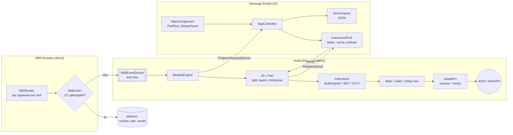

# Architectuur

## Componenten en threads

## Realtime-regels
De audio-thread wacht nooit en alloceert niets:
- MIDI komt binnen via een lock-free wachtrij (`SpscQueue`), parameters zijn `std::atomic`.
- Een nieuwe klank wordt **uitgeleend** (`Part::lend`) via één atomaire pointer. De audio-thread neemt hem
  aan het begin van het volgende blok over.
- De oude klank wordt de **tail**: noten die erop gestart zijn krijgen hun note-off en sustain daar
  (dus geen hangende noten). Na 3 s stilte gaat hij via `ReleaseQueue` terug naar de pool.
- Program Change die een beslissing vraagt (patchlijst, performance kiezen) gaat via
  `ProgramRequestQueue` naar de message-thread.
- NaN/inf uit een plug-in wordt per part weggefilterd, zodat de gedeelde effecten nooit vastlopen.

## Bestanden
| Map | Inhoud |
| --- | --- |
| `Source/Engine` | `ModuleEngine`, `Part`, instrumenten, effecten, `InstrumentPool` |
| `Source/Midi` | `MidiRouter` (apparaten, hot-plug), `MidiLearn`, `MidiEvent` + wachtrij |
| `Source/Model` | `Performance` (JSON met versienummer), `ProgramMap` |
| `Source/App` | `AppController`: verbindt alles, autosave, herstel na audio-uitval |
| `Source/Plugins` | Plug-in-scan in een apart proces |
| `Source/UI` | Interface (JUCE Components) |
| `Source/Render` | Offline renderen: MIDI-bestand naar WAV |
| `Tests` | Catch2-tests: filters, wachtrij, JSON, engine, MIDI Learn, sessie opslaan/herstellen |

## Uitbreiden in fase 2
- Sequencer als extra bron van `MidiEvent`s die de engine al begrijpt (`source = -1`).
- Opnemen: een ringbuffer achter de MIDI-router ("retrospective record") en de audio-uitgang.
- Offline export bestaat al als `OfflineRenderer`.
