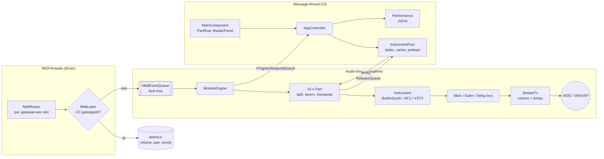

# Architectuur

## Componenten en threads

## Realtime-regels
De audio-thread wacht nooit en alloceert niets:
- MIDI komt binnen via een lock-free wachtrij (`SpscQueue`), parameters zijn `std::atomic`.
- Een nieuwe klank wordt **uitgeleend** (`Part::lend`) via één atomaire pointer. De audio-thread neemt hem
  aan het begin van het volgende blok over.
- De oude klank wordt de **tail**: noten die erop gestart zijn krijgen hun note-off en sustain daar
  (dus geen hangende noten). Na 3 s stilte gaat hij via `ReleaseQueue` terug naar de pool.
- Program Change die een beslissing vraagt (patchlijst, performance kiezen) gaat via
  `ProgramRequestQueue` naar de message-thread.
- NaN/inf uit een plug-in wordt per part weggefilterd, zodat de gedeelde effecten nooit vastlopen.

## Bestanden
| Map | Inhoud |
| --- | --- |
| `Source/Engine` | `ModuleEngine`, `Part`, instrumenten, effecten, `InstrumentPool` |
| `Source/Midi` | `MidiRouter` (apparaten, hot-plug), `MidiLearn`, `MidiEvent` + wachtrij |
| `Source/Model` | `Performance` (JSON met versienummer), `ProgramMap` |
| `Source/App` | `AppController`: verbindt alles, autosave, herstel na audio-uitval |
| `Source/Plugins` | Plug-in-scan in een apart proces |
| `Source/UI` | Interface (JUCE Components) |
| `Source/Render` | Offline renderen: MIDI-bestand naar WAV |
| `Tests` | Catch2-tests: filters, wachtrij, JSON, engine, MIDI Learn, sessie opslaan/herstellen |

## Arranger (fase 2a)
- `Sequencer` (in de engine, audio-thread): transport, loop, metronoom en aftellen. Speelt een
  onveranderlijke `PlaybackSnapshot` af; events gaan met `targetPart` rechtstreeks naar hun part.
- Elke part meldt wat hij van een keyboard ontvangt aan `Sequencer::capture` (na split, transpose en curve).
  Die zet het met maat/tel-positie in een lock-free wachtrij.
- `SongController` (message-thread) maakt daar clips van: per gewapend spoor, met een nieuwe take per
  loop-ronde, en bewaart alles ook 10 minuten voor *Vastleggen* achteraf.
- Bij elke wijziging bouwt de `SongController` een nieuwe snapshot; de oude wordt pas vrijgegeven als de
  audio-thread hem heeft losgelaten.
- `OfflineRenderer::renderEvents` exporteert een nummer naar WAV/FLAC via dezelfde engine.

## Pianorol (fase 2b)
- `Model/NoteEditing.h`: pure functies voor quantize (raster, sterkte, swing, lengtes), transponeren en
  controllerlijnen tekenen/wissen. Volledig getest zonder interface.
- `PianoRoll` werkt op een kopie van de clip en schrijft na elk afgerond gebaar terug via
  `SongController::setClipNotes` / `setClipControls`. Dat is precies één stap voor ongedaan maken.
- `SongController` bewaart vóór elke wijziging een kopie van het nummer (max. 100 stappen); snelle
  herhalingen van hetzelfde (tempo slepen) worden samengevoegd.
- Voorbeluisteren gaat via `AppController::previewNote`: een event met `targetPart` in de live-wachtrij,
  dus nooit opgenomen.
