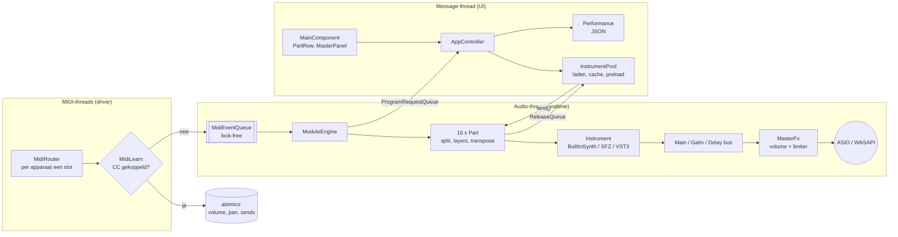

# Architectuur

## Componenten en threads

## Realtime-regels
De audio-thread wacht nooit en alloceert niets:
- MIDI komt binnen via een lock-free wachtrij (`SpscQueue`), parameters zijn `std::atomic`.
- Een nieuwe klank wordt **uitgeleend** (`Part::lend`) via één atomaire pointer. De audio-thread neemt hem
  aan het begin van het volgende blok over.
- De oude klank wordt de **tail**: noten die erop gestart zijn krijgen hun note-off en sustain daar
  (dus geen hangende noten). Na 3 s stilte gaat hij via `ReleaseQueue` terug naar de pool.
- Program Change die een beslissing vraagt (patchlijst, performance kiezen) gaat via
  `ProgramRequestQueue` naar de message-thread.
- NaN/inf uit een plug-in wordt per part weggefilterd, zodat de gedeelde effecten nooit vastlopen.

## Bestanden
| Map | Inhoud |
| --- | --- |
| `Source/Engine` | `ModuleEngine`, `Part`, instrumenten, effecten, `InstrumentPool` |
| `Source/Midi` | `MidiRouter` (apparaten, hot-plug), `MidiLearn`, `MidiEvent` + wachtrij |
| `Source/Model` | `Performance` (JSON met versienummer), `ProgramMap` |
| `Source/App` | `AppController`: verbindt alles, autosave, herstel na audio-uitval |
| `Source/Plugins` | Plug-in-scan in een apart proces |
| `Source/UI` | Interface (JUCE Components) |
| `Source/Render` | Offline renderen: MIDI-bestand naar WAV |
| `Tests` | Catch2-tests: filters, wachtrij, JSON, engine, MIDI Learn, sessie opslaan/herstellen |

## Arranger (fase 2a)
- `Sequencer` (in de engine, audio-thread): transport, loop, metronoom en aftellen. Speelt een
  onveranderlijke `PlaybackSnapshot` af; events gaan met `targetPart` rechtstreeks naar hun part.
- Elke part meldt wat hij van een keyboard ontvangt aan `Sequencer::capture` (na split, transpose en curve).
  Die zet het met maat/tel-positie in een lock-free wachtrij.
- `SongController` (message-thread) maakt daar clips van: per gewapend spoor, met een nieuwe take per
  loop-ronde, en bewaart alles ook 10 minuten voor *Vastleggen* achteraf.
- Bij elke wijziging bouwt de `SongController` een nieuwe snapshot; de oude wordt pas vrijgegeven als de
  audio-thread hem heeft losgelaten.
- `OfflineRenderer::renderEvents` exporteert een nummer naar WAV/FLAC via dezelfde engine.

## Pianorol (fase 2b)
- `Model/NoteEditing.h`: pure functies voor quantize (raster, sterkte, swing, lengtes), transponeren en
  controllerlijnen tekenen/wissen. Volledig getest zonder interface.
- `PianoRoll` werkt op een kopie van de clip en schrijft na elk afgerond gebaar terug via
  `SongController::setClipNotes` / `setClipControls`. Dat is precies één stap voor ongedaan maken.
- `SongController` bewaart vóór elke wijziging een kopie van het nummer (max. 100 stappen); snelle
  herhalingen van hetzelfde (tempo slepen) worden samengevoegd.
- Voorbeluisteren gaat via `AppController::previewNote`: een event met `targetPart` in de live-wachtrij,
  dus nooit opgenomen.

## Audiosporen en tempo (fase 3a)
- `Song` heeft een tempokaart (`tempoChanges`) met `beatToSeconds` / `secondsToBeat`. De `PlaybackSnapshot`
  krijgt een kopie; de sequencer neemt het tempo aan het begin van elk blok.
- `AudioCache` laadt audiobestanden in het geheugen op de samplerate van de geluidskaart (eenmalig
  omgezet) en maakt een golfvormoverzicht. De snapshot houdt de buffers vast met `shared_ptr`; vrijgeven
  gebeurt pas op de message-thread.
- `Sequencer::processAudio` speelt audioclips (in seconden), mengt meeluister-ingangen en schrijft
  opnames naar een `AudioFormatWriter::ThreadedWriter` (lock-free buffer, schijf-thread schrijft weg).
- Bij het afronden wordt de clip verschoven met de in+uit-latentie van de geluidskaart.
- Export speelt het hele nummer via een eigen engine + sequencer (`OfflineRenderer::renderSong`).

## Drums, arpeggiator en akkoorden (fase 3b)
- `BuiltInDrums` is een `Instrument` (ingebouwde klank nummer 8) met gesynthetiseerde stemmen per GM-noot;
  geen samples, geen allocatie in `process`. `DrumMap.h` geeft de rijnamen voor de drum-editor.
- `Arpeggiator` (header-only, geen allocatie) zit in elke `Part`. Binnenkomende noten gaan naar de
  arpeggiator; die maakt in `render` de noten voor het blok, gesynchroniseerd op de beat van de sequencer
  (`isBlockRolling`, `getBlockStartBeat`, `getTempoBeatsPerSample`) of vrij lopend. De gespeelde noten
  gaan naar het instrument en naar de opname-capture. Bij een klankwissel worden klinkende arp-noten in
  de staart-MIDI van het oude instrument losgelaten.
- Instellingen staan als atomics in `PartParams` en in `PartConfig` (JSON-object `arpeggiator`).
- `Chords.h` (pure functies): akkoordsoorten, namen, herkenning via een gewogen toonklassenprofiel
  (lengte x velocity, basnoot extra), per maat samengevoegd, voicing rond C4 en begeleiding.
- `Song.chords` (JSON `chords`: [beat, lengte, grondtoon, soort]) en `Track.drums`; alle wijzigingen via
  `SongController` en dus ongedaan te maken.

## Notenbalk en MIDI-uit (fase 3c)
- `Model/Notation.h` (pure functies, getest): spelling per toonsoort, toonsoort raden (Krumhansl-Kessler),
  per notenbalk één stem: kwantiseren voor weergave, akkoorden samenvoegen, rusten vullen, knippen op
  maatstrepen, notenwaarden kiezen die op de tel beginnen (met punten en overbindingen), voortekens per
  maat, waardestrepen per tel. `UI/ScoreView` tekent alleen het resultaat (glyphs uit Segoe UI Symbol /
  FreeSerif, de rest met paden) en kan een PNG maken.
- `Midi/MidiOutHub`: de audio-thread zet korte MIDI-berichten met een tijdstempel (blokstart + positie +
  uitgangslatentie + eigen correctie) in een lock-free wachtrij; een eigen thread met hoge prioriteit
  verstuurt ze op tijd. De bloktijd volgt de sampleklok en springt nooit een beetje terug (geen omgekeerde
  volgorde). Genereert ook MIDI-clock, Start/Continue (met Song Position Pointer) en Stop.
- `Engine/ExternalMidiInstrument` is een gewoon `Instrument` (type `midiout` in `InstrumentKey`, instellingen
  in `pluginState`): wisselen, staarten en panic werken daardoor zonder hangende noten op de hardware.

## MPE, MIDI 2.0 en CLAP (fase 3d)
- MPE: `PartParams::mpe` laat de part bij aanzetten of klankwissel de MPE Configuration Message en de
  buigbereiken (RPN 0) naar de klank sturen. `BuiltInSynth` verwerkt RPN 0/6, buiging en sustain op het
  managerkanaal, en per kanaal druk en CC74 (`Expression`, gedeeld met de stemmen).
- MIDI 2.0: `MidiRouter` kan ingangen openen via JUCE's UMP-API (`ump::Session::connectInput`, protocol
  MIDI 2.0). `Midi2Translator` (getest) zet UMP om naar de MIDI 1.0-events van de engine volgens de
  vertaalregels van de MIDI 2.0-standaard en verdeelt per-noot-expressie over MPE-kanalen.
- CLAP: `Plugins/ClapHosting` is een `juce::AudioPluginFormat` + `AudioPluginInstance`. Daardoor werken
  scannen (apart proces), de plug-inlijst, de pool, staat opslaan en het editorvenster zonder extra code.
  Host-extensies: log, thread-check, params, state, latency, gui, note-ports, audio-ports. Noten gaan als
  MIDI (als de plug-in dat dialect kent) of als CLAP-note-events; parameterwijzigingen van de host gaan via
  een wachtrij als param-value-events het audioblok in, wijzigingen van de plug-in komen via de out-events
  terug. Op Windows wordt het plug-invenster als win32-kindvenster ingebed (`HWNDComponent`).
